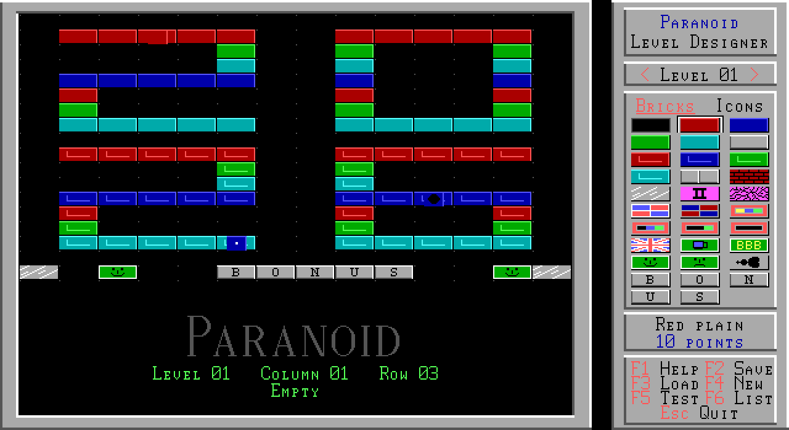
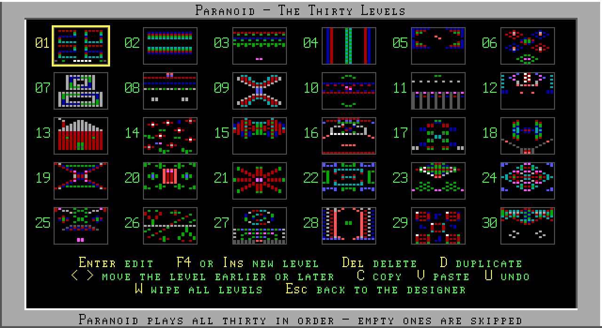
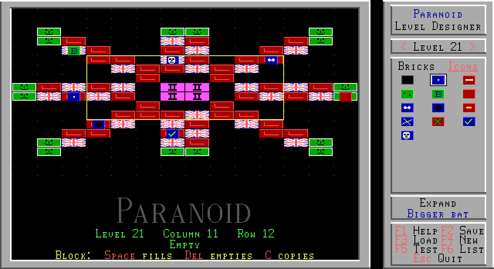

# Paranoid Level Designer

*An unofficial level editor for Paranoid, the 1993 DOS game.*

**Paranoid** is an Arkanoid-style DOS game from 1993 by Ben and Tom North
("The Bit Bucket Brothers"). This is an unofficial level editor for Paranoid
v1.8. It is a real DOS program that runs next to the game in DOSBox, and it
draws everything with the game's own bricks, icons, fonts and logo.







## Features

- Edit all 30 levels: every brick type, and the 12 power-up icons hidden
  inside bricks.
- Works with the keyboard alone or with the mouse:
  - Tab moves between the play area, the brick panel and the level box.
  - Shift+arrows draw as you move.
  - Mark a block to fill, empty or copy it.
- Copy and paste, mirror, clear and undo.
- **Level list (F6):** add a new level anywhere, delete, duplicate and
  reorder levels.
- **Test-play (F5):** runs Paranoid with your level as level 1, and puts
  everything back afterwards, high scores included.
- **Safe saving:** your original levels are kept, and a failed save can't
  damage the game's levels file. See below.
- Help pages and a title screen in the style of the original game.

## Getting started

You need **Paranoid v1.8**, the 1993 shareware release, and
[DOSBox](https://www.dosbox.com/). The game itself is *not* included here.

1. Download `DESIGNER.EXE` from the [Releases](../../releases) page.
2. Copy it into your Paranoid folder, next to `PARANOID.COM`.
3. Start DOSBox in that folder and run the designer, for example:

   ```
   dosbox -c "mount c C:\GAMES\PARANOID" -c "c:" -c "DESIGNER"
   ```

Press **F1** in the designer for help.

| Key | Action |
|---|---|
| Arrow keys / Shift+arrow keys | Move / draw while moving |
| Space, Delete | Place / remove the chosen brick or icon |
| Tab, Ctrl+arrow keys | Move between screen areas / choose a brick |
| I | Switch between bricks and icons |
| B | Mark a block (then Space, Delete or C) |
| C, V, M, U, N | Copy, paste, mirror, undo, clear the level |
| PgUp, PgDn | Previous / next level |
| F2, F3 | Save / load (last save, backup or original) |
| F4, F5, F6 | New level / test-play / level list |

## Your original levels are safe

The game has only one levels file, `LEVELS.PAR`, so the designer is careful
with it:

- **`LEVELS.ORG`:** on the first save, the original levels are copied here.
  This file is never written over.
- **`LEVELS.BAK`:** before every save, the previous version is copied here.
- If a backup can't be made, nothing is saved.
- New levels are written to a temporary file first, and replace `LEVELS.PAR`
  only once complete.
- **F3 → Original** brings back the game's own levels.

The game always plays exactly thirty levels. An empty level is passed over as
soon as the ball is launched, so keep your levels at the front of the list.

## Building from source

The designer is one C file, built with
[Open Watcom 2.0](https://github.com/open-watcom/open-watcom-v2) for 16-bit DOS:

```
set WATCOM=C:\WATCOM
BUILD.BAT
```

Don't add `-ox`: its loop optimiser miscompiles the video code.

## Credits and legal

- **Paranoid** © 1993 Ben North and Tom North. This project is not affiliated
  with or endorsed by them.
- No part of the game is included in this repository. The designer reads the
  graphics, fonts and levels from your own copy of Paranoid when it runs.
- The designer's source code is released under the [MIT License](LICENSE).
